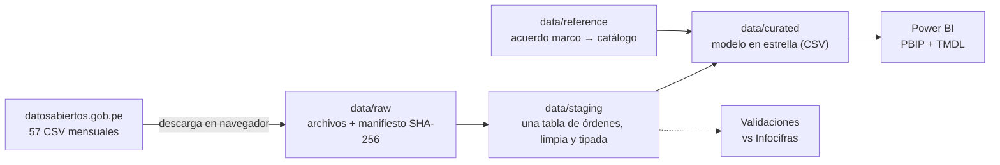

# Fase 0 — Definición del proyecto

> Estado: **cerrada** (2026-10-13). Todo lo que este documento afirma sobre las fuentes se
> comprobó en esa fecha, leyendo los 57 archivos completos y las Infocifras oficiales de 2024 y
> 2025 ([sección 4.3](#43-cifra-oficial-para-validar)).

## 1. El problema

Los **Catálogos Electrónicos de Acuerdos Marco** son la vía por la que una entidad pública
compra bienes estandarizados (computadoras, útiles, consumibles, materiales de construcción…)
sin hacer un proceso de selección: elige en una tienda virtual entre proveedores ya
homologados por Perú Compras. Entre enero de 2022 y setiembre de 2026 pasaron por ahí
**S/ 8 519 millones** en 511 782 órdenes de compra de bienes.

Al ser compra directa, la competencia no ocurre en cada orden sino dentro de cada catálogo. El
monto total no dice si un catálogo depende de pocos proveedores, qué entidades concentran el
gasto, ni si las compras se amontonan en ciertos meses.

**Pregunta central.** ¿Cuánto y en qué compra el Estado por Catálogos Electrónicos, qué tan
concentrada está la venta en cada catálogo, quién compra y en qué momento del año?

**Usuario del tablero.** La gerencia que administra los acuerdos marco y prepara el reporte de
gestión del catálogo. Con los filtros, el jefe de logística de una entidad puede ver su propia
compra frente al resto.

### Preguntas que el tablero debe responder

| # | Pregunta | Dónde se responde |
|---|---|---|
| P1 | ¿Cuánto se compra, en qué catálogos, y cómo cambia año a año? | Página *Resumen* y *Catálogos* |
| P2 | ¿En qué catálogos la venta depende de pocos proveedores? | Página *Concentración* |
| P3 | ¿Qué entidades concentran el gasto, y en qué catálogos? | Página *Entidades* |
| P4 | ¿Cómo se reparte la compra a lo largo del año? | Página *Calendario* |
| P5′ | ¿Se usa la Gran Compra donde corresponde? | Página *Gran Compra* |

**Cambio aprobado en la Fase 2.** La P5 original (*¿qué parte de las órdenes figura pagada al mes
siguiente?*) se descartó: el estado "Pagada" tiene un quiebre de siete meses que no refleja la
realidad ([Fase 2, sección 9](02_calidad.md#9-qué-pasa-con-la-pregunta-p5)). La reemplaza la P5′.

## 2. Indicadores

Montos en soles, **con IGV** (columna `TOTAL`), tal como los publica Perú Compras.

| Indicador | Definición | Columnas |
|---|---|---|
| Monto comprado | Suma de `TOTAL` | `TOTAL` |
| Órdenes | Número de órdenes distintas | `ORDEN_ELECTRÓNICA` |
| Ticket promedio | Monto / Órdenes | Calculada |
| Proveedores y entidades activos | Número de RUC distintos con al menos una orden | `RUC_PROVEEDOR`, `RUC_ENTIDAD` |
| Participación de un proveedor | Monto del proveedor / Monto del catálogo | Calculada |
| Índice de concentración (HHI) | Suma de las participaciones al cuadrado, en una escala de 0 a 10 000 | Calculada por catálogo |
| Proveedores que suman el 80 % | Menor número de proveedores que acumula el 80 % del monto | Calculada |
| Participación del último trimestre | Monto de octubre a diciembre / Monto del año | `FECHA_FORMALIZACIÓN` |
| Peso de la Gran Compra | Monto en `Gran Compra` / Monto total | `TIPO_PROCEDIMIENTO` |
| Compras ordinarias sobre el umbral | Órdenes por *Compra ordinaria* de S/ 100 000 o más, y su monto | `TIPO_PROCEDIMIENTO`, `TOTAL` |
| Variación interanual | Valor del periodo frente al mismo periodo del año anterior | Calculada |

Todos los ratios se calculan desde montos o conteos (suma sobre suma); nunca se promedian
porcentajes.

**Lectura del HHI.** Menos de 1 500: poco concentrado; 1 500 a 2 500: moderado; más de 2 500:
alto. Son los umbrales de las guías de fusiones de EE. UU. de 2010, usados aquí solo como
referencia para leer el índice.

## 3. Alcance

**Incluido**
- Órdenes de compra de **bienes** formalizadas por Catálogos Electrónicos, de enero de 2022 a
  setiembre de 2026 (57 meses), con todos sus estados.
- Todas las entidades y proveedores que aparecen en el periodo.

**Fuera de alcance, y por qué**
- *Órdenes de servicios.* Perú Compras publicaba un conjunto aparte, pero hoy pide iniciar
  sesión y no aparece en el buscador del portal.
- *Análisis por región o por nivel de gobierno.* Los archivos no traen la ubicación ni el tipo
  de la entidad, solo su RUC y nombre. Clasificarlas a mano por nombre sería poco fiable.
- *Precios unitarios.* Cada fila es una orden completa, sin el detalle de productos ni de
  cantidades. No se puede comparar el precio de un mismo bien entre entidades.
- *Tamaño del proveedor (mype).* No viene en los datos.
- *Modelos predictivos.* Es un proyecto de analítica descriptiva y diagnóstica.

## 4. Reconocimiento de las fuentes

### 4.1 Perú Compras — Órdenes de compra de los Catálogos Electrónicos

Conjunto *Órdenes de compra realizadas a través de los Catálogos Electrónicos*, en la
[Plataforma Nacional de Datos Abiertos](https://www.datosabiertos.gob.pe/dataset/%C3%B3rdenes-de-compra-realizadas-trav%C3%A9s-de-los-cat%C3%A1logos-electr%C3%B3nicos-central-de-compras).
Un CSV por mes de formalización, más un diccionario en PDF:

```
https://www.datosabiertos.gob.pe/sites/default/files/ReportePCBienes{AAAAMM}.csv
```

| Dato | Valor |
|---|---|
| Archivos | 57 (2022-01 a 2026-09), sin meses faltantes; 262 MB en total |
| Publicación | Alrededor del día 1 del mes siguiente (el de 2026-09 se subió el 2026-10-01) |
| Filas | 511 782 órdenes, ninguna repetida dentro de un archivo ni entre archivos |
| Separador | `;`, con una sola versión del encabezado (19 columnas) en todos los meses |
| Volumen | De 459 órdenes (enero de 2026) a 16 746 (marzo de 2022) por mes |
| Universo | 3 569 proveedores, 3 378 entidades, 72 acuerdos marco |

Columnas: `FECHA_PROCESO`, `RUC_PROVEEDOR`, `PROVEEDOR`, `RUC_ENTIDAD`, `ENTIDAD`,
`TIPO_PROCEDIMIENTO` (*Compra ordinaria* o *Gran Compra*), `ORDEN_ELECTRÓNICA`, enlace al PDF
de la orden, `ESTADO_ORDEN_ELECTRÓNICA`, enlace al documento de estado,
`FECHA_FORMALIZACIÓN`, `FECHA_ÚLTIMO_ESTADO`, `SUB_TOTAL`, `IGV`, `TOTAL`, enlace a la orden
digitalizada, `DESCRIPCIÓN_ESTADO`, `DESCRIPCIÓN_CESIÓN_DERECHOS`, `ACUERDO_MARCO`.

**Acceso.** El portal responde **418** a los clientes que no son navegadores (curl, Python) y
**200** desde el navegador. **No se intenta evadirlo.** Los archivos se descargan desde el
navegador y se registran en un manifiesto con su tamaño y su hash SHA-256. `src/extract.py`
verifica el manifiesto en lugar de descargar. Ver la Fase 1.

### 4.2 Problemas de calidad detectados

Se leyeron los 57 archivos completos. Todo lo siguiente se resolverá en las Fases 2 y 3:

1. **La codificación cambia.** 56 archivos vienen en Windows-1252 y el de marzo de 2024 en
   UTF-8. El lector debe probar UTF-8 y caer a Windows-1252.
2. **Tabuladores al inicio de los campos.** En marzo de 2024 muchos valores empiezan con `\t`
   (`\tACEPTADA`, `\tCompra ordinaria`). Sin limpiarlos, un mismo estado se cuenta como dos y
   el número de proveedores distintos sube de 3 569 a 4 850.
3. **El formato de fecha cambia.** Junio de 2024 usa `d/mm/aaaa` con espacios al final; el
   resto, `aaaa-mm-dd hh:mm:ss`.
4. **Archivos republicados.** Cuatro meses tienen sufijo `_0` (`202302_0`, `202403_0`,
   `202411_0`, `202501_0`): el portal reemplazó una primera versión. Se usa el nombre que
   publica el portal en cada fecha y se anota en el manifiesto.
5. **El acuerdo marco mezcla código y nombre, y el nombre varía.** `IM-CE-2020-5 COMPUTADORAS
   DE ESCRITORIO…` y `EXT-CE-2021-6 IMPRESORAS…` son versiones sucesivas de catálogos
   parecidos, y el mismo catálogo aparece con espacios dobles o palabras en otro orden. Hace
   falta una tabla de mapeo hecha a mano (`data/reference/`): acuerdo marco → catálogo estable.
   Solo cómputo (escritorio, portátiles y escáneres) suma cerca de un tercio del monto.
6. **El estado es una foto al corte de cada archivo.** `FECHA_PROCESO` es el día 1 del mes
   siguiente desde mayo de 2022, así que el porcentaje de órdenes pagadas mide lo mismo en cada
   mes: cuántas figuran pagadas unas semanas después. Los cuatro primeros meses de 2022 se
   procesaron todos el 2022-05-12 y no son comparables. Además, el 89 % del monto figura
   *Aceptada* y solo el 11 % *Pagada*. Hay que confirmar en la Fase 2 si las entidades
   actualizan ese estado. Si no lo hacen, P5 se descarta y se explica por qué.
7. **Estados que no son compra.** *Orden de compra nula* (S/ 3,8 millones) y *Resuelta*
   (S/ 3,4 millones) se separan del monto comprado y se reportan aparte.

### 4.3 Cifra oficial para validar

Perú Compras publica cada mes las **Infocifras de Catálogos Electrónicos**, con el monto y el
número de órdenes acumulados del año, en su
[colección de boletines](https://www.gob.pe/institucion/perucompras/colecciones/689-boletines-peru-compras).
Es la cifra contra la que se valida el pipeline, igual que el boletín de la SBS en el proyecto
de morosidad. Las de cierre de año se guardan en [`docs/fuentes/`](fuentes/).

La Infocifra separa **bienes** de **servicios** (el servicio es la emisión de boletos aéreos,
que no está en estos archivos), así que se compara contra la cifra de bienes. Sumando los 12
archivos de cada año, con todos los estados:

| Año | Bienes, Infocifra n.° 12 | Bienes, datos abiertos | Diferencia |
|---|---|---|---|
| 2024 | S/ 1 939,34 millones | S/ 1 934,6 millones | −0,24 % |
| 2025 | S/ 1 792,44 millones | S/ 1 778,9 millones | −0,75 % |

Las dos diferencias están por debajo del 1 %. En la Fase 2 se repite el cálculo con los datos
ya limpios y se compara también el monto por tipo de procedimiento, que la Infocifra publica:
Gran Compra S/ 1 172,99 y Compra ordinaria S/ 766,35 millones en 2024; S/ 1 113,17 y
S/ 679,27 millones en 2025.

**Ojo con el problema 3.** Agrupar por año con los cuatro primeros caracteres de la fecha deja
fuera junio de 2024 (fecha `d/mm/aaaa`) y marzo de 2024 (tabulador al inicio). Así, 2024
suma solo S/ 1 627 millones (−16 %). Es la prueba de que esos dos meses necesitan su regla de
limpieza y su prueba automática.

Las Infocifras de 2024 y 2025 también dan el monto por tipo de entidad y por región de entrega,
que estos archivos no traen. Sirven de contexto en la página *Notas*, citando la fuente.

## 5. Arquitectura prevista



| Capa | Contenido | ¿Se versiona? |
|---|---|---|
| `data/raw` | CSV tal como se descargan + manifiesto (URL, fecha, bytes, SHA-256) | No, solo el manifiesto |
| `data/staging` | Órdenes en una sola tabla, sin tabuladores, fechas ISO, codificación única | No |
| `data/curated` | Hechos y dimensiones que lee Power BI | **Sí**, para abrir el tablero sin ejecutar nada |

**Modelo en estrella previsto**
- Hecho: `fact_orden` (una fila por orden: fechas, monto, IGV, estado, tipo de procedimiento).
- Dimensiones: `dim_fecha`, `dim_proveedor` (RUC, nombre vigente), `dim_entidad` (RUC, nombre
  vigente), `dim_catalogo` (acuerdo marco, catálogo estable, vigencia), `dim_estado`.

## 6. Cómo se mostrará el tablero

- **Publicado en la web de Power BI**, con el enlace en el README, en el *Website* del
  repositorio y en la tarjeta del portafolio.
- Proyecto **PBIP** con el modelo en **TMDL**, para que las medidas DAX y el Power Query se lean
  como texto en GitHub.
- Una captura de cada página en `docs/img/`, con su conclusión en el README.

## 7. Criterios de éxito

- [ ] `src/extract.py` verifica los 57 archivos contra el manifiesto y no vuelve a procesar lo
      que no cambió.
- [ ] El 100 % de los acuerdos marco está asignado a un catálogo estable.
- [ ] El monto de bienes por año y por tipo de procedimiento coincide con las Infocifras
      (diferencia < 1 %), o cada diferencia está explicada.
- [ ] Las medidas DAX clave coinciden con el mismo cálculo en Python.
- [ ] Cada pregunta P1–P5 tiene una página del tablero y una conclusión en el README (o una
      explicación de por qué se descartó).
- [ ] Pruebas automáticas en GitHub Actions, con recortes de los archivos difíciles (marzo y
      junio de 2024).

## 8. Plan de fases

| Fase | Entregable | Documento |
|---|---|---|
| 0. Definición | Problema, KPIs, alcance y reconocimiento de la fuente | este archivo |
| 1. Adquisición | Descarga en navegador + `src/extract.py` que verifica el manifiesto | `docs/01_adquisicion.md` |
| 2. Calidad | Perfilado de los 57 meses, diccionario y validación contra Infocifras | `docs/02_calidad.md` |
| 3. Transformación | raw → staging → curated, mapa de catálogos | `docs/03_transformacion.md` |
| 4. Modelado | Modelo en estrella + medidas DAX en TMDL, validadas contra Python | `docs/04_modelado.md` |
| 5. Análisis | Respuestas a P1–P5 con cifras | `docs/05_analisis.md` |
| 6. Tablero | PBIP + capturas | `powerbi/`, `docs/img/` |
| 7. Hallazgos | Conclusiones y limitaciones | README |
| 8. Automatización | Pruebas + GitHub Actions | `.github/workflows/` |
| 9. Publicación | Enlace público en el README, el repositorio y el portafolio | README |
