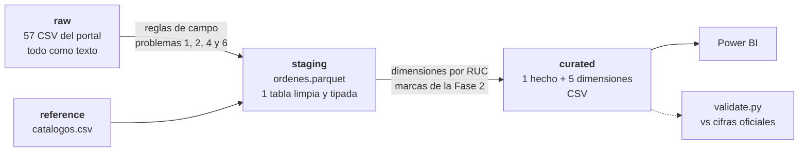
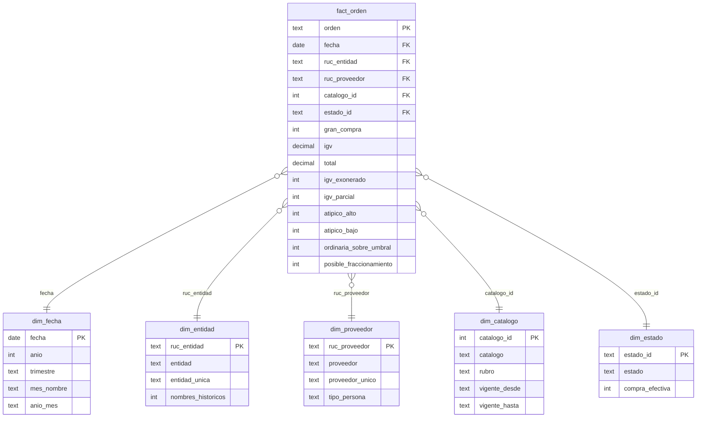

# Fase 3 — Transformación

> Estado: **cerrada** (2026-10-13).

## 1. Resumen

Las 511 782 órdenes pasan de 57 archivos de texto a un **modelo en estrella**: un hecho y cinco
dimensiones, listo para Power BI. **Ninguna orden se excluye y ningún sol se pierde**:

- raw, staging y curated tienen las mismas 511 782 órdenes y los mismos S/ 8 518 530 615;
- el script se detiene si un paso no cuadra al céntimo.

Lo que la Fase 2 marcó como atípico o fuera de regla queda como **columna de marca**, no como
filtro. Así gerencia decide qué ver, y el total siempre se puede reconstruir.

```bash
python -m src.transform   # raw → staging → curated, con linaje y controles de integridad
python -m src.validate    # compara el modelo curado con las cifras oficiales
```

## 2. Capas



| Capa | Qué tiene | Formato | ¿Se versiona? |
|---|---|---|---|
| `data/raw/ordenes/` | Los 57 archivos, byte a byte como los publica el portal | CSV | No (se regeneran con la Fase 1); sí el manifiesto |
| `data/staging/ordenes.parquet` | Una sola tabla con las 19 columnas limpias y tipadas, más código de acuerdo, catálogo y rubro | Parquet | No |
| `data/curated/` | El modelo en estrella | CSV | **Sí**: el tablero abre sin ejecutar nada |

**Por qué Parquet en staging.** Guarda los tipos (fechas, montos) y ocupa una fracción del CSV. Es
el formato natural para una capa intermedia que solo leen scripts. Curated va en CSV porque lo
lee Power BI y porque se revisa en GitHub.

## 3. Modelo en estrella



| Tabla | Grano | Filas | Tamaño |
|---|---|---|---|
| `fact_orden` | Una orden de compra | 511 782 | 45,5 MB |
| `dim_entidad` | Un RUC de entidad | 2 348 | 0,3 MB |
| `dim_proveedor` | Un RUC de proveedor | 3 569 | 0,4 MB |
| `dim_catalogo` | Un catálogo estable | 29 | — |
| `dim_estado` | Un estado de la orden | 5 | — |
| `dim_fecha` | Un día, de 2022-01-01 a 2026-09-30 | 1 734 | 0,1 MB |

### Decisiones del modelo

1. **El grano es la orden.** Es lo más fino que publica la fuente: no hay detalle por producto.
2. **La identidad de entidades y proveedores es el RUC** (problemas 8 y 9 de la Fase 2):
   - el nombre que se muestra es el más reciente, y `nombres_historicos` dice cuántos tuvo;
   - `entidad_unica` agrega el RUC solo cuando dos entidades comparten nombre. Son 67, entre
     ellas las tres *Municipalidad Distrital de Miraflores*. Sin esto, Power BI las sumaría como
     una sola.
3. **Catálogo y rubro en una sola dimensión.** Los 95 textos de acuerdo marco se convierten en
   29 catálogos y 10 rubros con [`catalogos.csv`](../data/reference/catalogos.csv). La jerarquía
   rubro → catálogo permite bajar del resumen al detalle.
4. **El estado es una dimensión de 5 filas,** con la columna `compra_efectiva` (0 para nula y
   resuelta). El tablero puede mostrar el monto oficial o solo las compras efectivas con el
   mismo filtro.
5. **Columnas pequeñas en el hecho.** El hecho lleva códigos y marcas de 0/1 en lugar de textos
   repetidos: `estado_id` es una letra y `gran_compra` es 0/1. Así pesa 45,5 MB, por debajo del
   aviso de 50 MB de GitHub (el límite es 100 MB).
6. **El subtotal no se guarda:** es `total − igv`, y Power BI lo calcula si hace falta.
7. **Un calendario propio** (`dim_fecha`) en español, con el año fiscal igual al calendario.
   Permite que la estacionalidad (P4) se lea por mes, trimestre y día de la semana, y `mes_inicio`
   (primer día del mes) da al tablero un eje mensual continuo.

## 4. Linaje de columnas

| Columna de origen | Destino | Transformación |
|---|---|---|
| `ORDEN_ELECTRÓNICA` | `fact_orden.orden` | Sin tabuladores; clave primaria |
| `FECHA_FORMALIZACIÓN` | `fact_orden.fecha` → `dim_fecha` | Dos formatos de fecha → fecha ISO, sin hora |
| `RUC_ENTIDAD`, `ENTIDAD` | `fact_orden.ruc_entidad` → `dim_entidad` | Nombre más reciente; RUC al lado si el nombre se repite |
| `RUC_PROVEEDOR`, `PROVEEDOR` | `fact_orden.ruc_proveedor` → `dim_proveedor` | Igual, más `tipo_persona` según el prefijo del RUC (10 natural, 20 jurídica) |
| `ACUERDO_MARCO` | `fact_orden.catalogo_id` → `dim_catalogo` | Código y nombre separados, nombre normalizado, mapeo a catálogo y rubro |
| `ESTADO_ORDEN_ELECTRÓNICA` | `fact_orden.estado_id` → `dim_estado` | Código de una letra |
| `TIPO_PROCEDIMIENTO` | `fact_orden.gran_compra` | 1 = Gran Compra, 0 = Compra ordinaria |
| `IGV`, `TOTAL` | `fact_orden.igv`, `fact_orden.total` | Redondeo a céntimos |
| `SUB_TOTAL` | — | Se omite: es `total − igv` |
| `FECHA_PROCESO`, `FECHA_ÚLTIMO_ESTADO` | staging | Sin uso en el tablero tras descartar la P5 |
| Las 3 URL y las 2 descripciones | staging | Casi vacías o sin uso analítico (problema 16) |

**Marcas que se agregan** (vienen de la Fase 2):

| Columna | Es 1 cuando… | Órdenes | Monto |
|---|---|---|---|
| `igv_exonerado` | IGV = 0 (problema 12) | 19 217 | S/ 243,4 millones |
| `igv_parcial` | IGV > 0 y lejos del 18 % (problema 12) | 394 | S/ 7,2 millones |
| `atipico_alto` | Monto > S/ 3 444 382 (problema 14) | 120 | S/ 1 010,9 millones |
| `atipico_bajo` | Monto < S/ 2,53 (problema 13) | 26 | S/ 35 |
| `ordinaria_sobre_umbral` | Compra ordinaria ≥ S/ 100 000 (P5′, problema 17) | 785 | S/ 121,4 millones |
| `posible_fraccionamiento` | Compra ordinaria que, con otras de la misma entidad, proveedor, catálogo y día, supera S/ 100 000 aunque cada una esté por debajo (P5′; se agregó en la Fase 6 para el tablero) | 2 824 | S/ 124,3 millones |

La Fase 2 contó 119 atípicos altos y aquí son 120. Allá, una orden muy alta que además está
anulada se contó solo como "estado que no es compra". Aquí las marcas son independientes: una
orden puede tener varias.

## 5. Linaje de filas y montos

[`reports/linaje.csv`](../reports/linaje.csv):

| Paso | Qué es | Órdenes | Monto | Columnas |
|---|---|---|---|---|
| 1. raw | 57 CSV del portal | 511 782 | S/ 8 518 530 615 | 19 |
| 2. staging | Tabla limpia y tipada | 511 782 | S/ 8 518 530 615 | 23 |
| 3. curated | `fact_orden` | 511 782 | S/ 8 518 530 615 | 15 |
| 3a. marca | Compra efectiva (sin nulas ni resueltas) | 511 442 | S/ 8 511 264 017 | — |
| 3b. marca | Atípicos de monto alto | 120 | S/ 1 010 899 293 | — |
| 3c. marca | Compras ordinarias sobre el umbral | 785 | S/ 121 385 236 | — |
| 3d. marca | Posibles compras partidas | 2 824 | S/ 124 271 228 | — |

Los pasos 1, 2 y 3 tienen que coincidir en órdenes y en monto (±S/ 0,05 por redondeo). Si no
coinciden, `transform.py` no escribe nada y termina con error.

## 6. Controles de integridad

`transform.py` los ejecuta antes de escribir, y [`tests/test_curated.py`](../tests/test_curated.py)
los repite en GitHub Actions sobre los CSV versionados:

- **Claves primarias únicas** en las seis tablas.
- **Integridad referencial:** cada orden encuentra su fecha, entidad, proveedor, catálogo y
  estado. Cero huérfanos.
- **Cero nulos** en el hecho.
- **Nombres únicos para el tablero:** `entidad_unica` y `proveedor_unico` no se repiten.
- **Coherencia de las marcas.** Toda orden `igv_exonerado` tiene IGV 0. Toda
  `ordinaria_sobre_umbral` es compra ordinaria de S/ 100 000 o más.
- **Exactitud:** el modelo curado reproduce las 15 comparaciones con las cifras oficiales.
  `python -m src.validate` da exactamente el mismo resultado que en la Fase 2.

## 7. Límites y lo que viene

- **El hecho crece unos 0,6 MB por mes.** Llegaría a 50 MB (el aviso de GitHub) en unos siete
  meses. Si se actualiza, conviene partirlo por año.
- **Entidades sin tipo de gobierno.** Los archivos no dicen si una entidad es del gobierno
  nacional, regional o local, y clasificarlas por nombre sería poco fiable. El tablero lo dice en
  sus notas.
- **Fase 4:** el modelo en Power BI (PBIP con TMDL), con las medidas DAX validadas contra Python.
