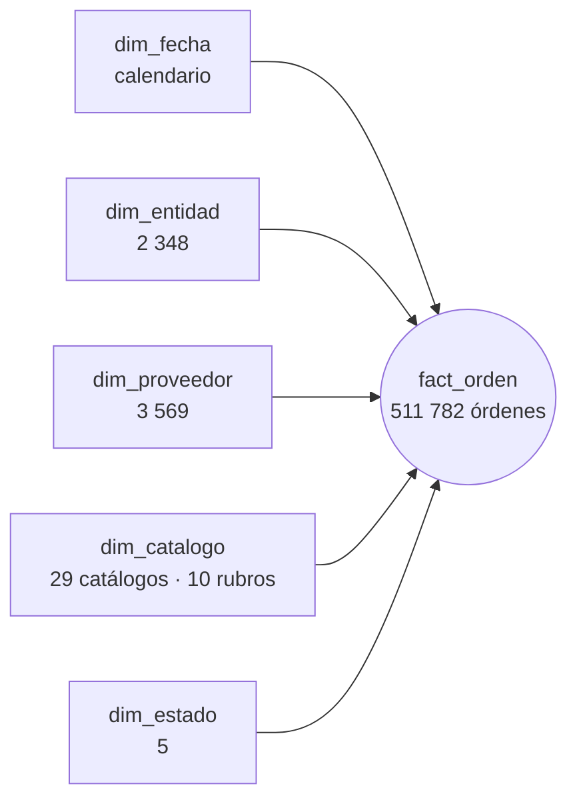

# Fase 4 — Modelado en Power BI

> Estado: **cerrada** (2026-10-13).

## 1. Resumen

El modelo de Power BI se guarda como **proyecto PBIP con TMDL**: el modelo, el Power Query y las
37 medidas DAX están en archivos de texto que se leen en GitHub. No se armó a mano. Lo genera un
script ([`tools/build_model.py`](../tools/build_model.py)), así que es reproducible y cualquier
cambio queda en el historial.

**Las 37 medidas se validaron contra Python.** En **296 comparaciones** (en total, por año y en
cada uno de los 29 catálogos) la diferencia máxima es de 4,8 × 10⁻¹³, que es error de punto
flotante. Las medidas de texto (proveedor líder, nivel de concentración, fecha de corte) también
coinciden.

```bash
python tools/build_model.py              # genera powerbi/perucompras.SemanticModel
python tools/validate_measures.py consulta
# ejecutar tools/validacion_medidas.dax en Power BI y guardar el resultado como CSV
python tools/validate_measures.py comparar reports/medidas_dax.csv
```

## 2. Modelo



- **Cinco relaciones** de muchos a uno, con filtro en un solo sentido: de la dimensión al hecho.
  Es el esquema en estrella clásico y evita ambigüedades.
- **`dim_fecha` está marcada como tabla de fechas,** con `fecha` como clave. Por eso funcionan las
  funciones de inteligencia de tiempo, como la comparación con el año anterior.
- **Columnas técnicas ocultas:** claves foráneas, montos crudos y marcas de 0/1. Quien arma un
  visual ve medidas y atributos, no columnas que sumadas a mano darían resultados engañosos. El
  modelo además desactiva las medidas implícitas (`discourageImplicitMeasures`).
- **Orden natural de los textos:** `mes_nombre` se ordena por `mes` y `dia_semana` por
  `dia_semana_num`. Así "enero" va antes que "febrero" y no se ordena alfabéticamente.
- **Cultura `es-PE`** para mostrar los números, y **`en-US` para leer los CSV.** Sin esa cultura
  explícita, Power Query lee "129.8" como 1298 en un equipo configurado en español.
- **Parámetro `RutaDatos`.** Es la carpeta `data/curated/`. Quien clone el repositorio la cambia
  en un solo lugar.

**Comprobación tras cargar:** 511 782 órdenes y S/ 8 518 530 614,92, iguales al céntimo al linaje
de Python. Cero órdenes sin fecha, entidad, proveedor, catálogo o estado.

## 3. Medidas

Las 37 medidas viven en la tabla `_Medidas`, en carpetas por pregunta. Cada una tiene una
descripción, que Power BI muestra al pasar el mouse.

### 1. Compras (P1)

| Medida | Definición |
|---|---|
| Monto | `SUM(total)`: con IGV y todos los estados, como la cifra oficial |
| Monto (S/ millones) | Monto / 1 000 000 |
| Órdenes | Número de órdenes |
| Ticket promedio | Monto / Órdenes |
| Ticket mediano | Mediana del monto por orden: la orden típica, sin el peso de las compras enormes |
| Entidades compradoras · Proveedores con ventas | RUC distintos con al menos una orden |
| Monto compra efectiva | Monto sin órdenes nulas ni resueltas |
| Monto mismo periodo año anterior | `DATEADD(fecha, −1, YEAR)` |
| Var. interanual | (Monto − año anterior) / año anterior |
| Participación en el monto | Monto / monto de todo lo seleccionado |

**Comparación justa con 2026.** El calendario termina el 30 de setiembre de 2026. Por eso
`DATEADD` compara enero–setiembre de 2026 con enero–setiembre de 2025, y no con todo 2025. Con
esta definición, 2026 va **−21,2 %**. Si se comparara con el año completo, la caída parecería del
48 %.

### 2. Concentración (P2)

| Medida | Definición |
|---|---|
| Participación del proveedor | Monto del proveedor / monto del contexto sin filtrar proveedor |
| **HHI** | Suma de las participaciones al cuadrado, en escala de 0 a 10 000 |
| Nivel de concentración | Baja (< 1 500), Moderada (1 500–2 500), Alta (> 2 500) |
| Participación top 3 / top 10 proveedores | Parte del monto de los 3 o 10 mayores del contexto |
| Proveedores para el 80 % | Menor número de proveedores que, de mayor a menor, acumulan el 80 % del monto |
| Proveedor líder · Participación del líder | El mayor proveedor del contexto y su parte |

**El HHI se lee por catálogo.** Sobre todo el mercado da 48, casi cero, porque hay 3 569
proveedores repartidos en 29 catálogos que no compiten entre sí. Dentro de cada catálogo cambia
mucho: 78 en *Impresoras y consumibles* y 3 726 en *Medidores eléctricos*. El tablero lo muestra
siempre por catálogo.

### 3. Entidades (P3)

| Medida | Definición |
|---|---|
| Participación de la entidad | Monto de la entidad / monto del contexto sin filtrar entidad |
| Participación top 10 entidades | Parte del monto de las 10 mayores entidades del contexto |
| Catálogos usados | Catálogos distintos con compras |

### 4. Calendario (P4)

| Medida | Definición |
|---|---|
| Participación del mes en el año | Monto del mes / monto del año |
| Participación del último trimestre | Monto de octubre a diciembre / monto del año |
| Participación de diciembre | Monto de diciembre / monto del año |

Solo tienen sentido en años completos (2022 a 2025). En 2026 quedan en blanco, porque no hay datos
de octubre a diciembre.

### 5. Gran Compra (P5′)

| Medida | Definición |
|---|---|
| Monto Gran Compra · Monto compra ordinaria | Monto por cada procedimiento |
| % Gran Compra | Monto Gran Compra / Monto |
| Órdenes ordinarias sobre el umbral · Monto ordinario sobre el umbral | Compras ordinarias de S/ 100 000 o más |
| % ordinario sobre el umbral | Monto ordinario sobre el umbral / monto de compra ordinaria |

### 6. Calidad de datos y 7. Textos

Monto con IGV exonerado, órdenes atípicas altas y su peso en el monto, órdenes que no son compra.
Además, dos textos para el tablero: la **fecha de corte** ("Órdenes formalizadas hasta el 30 de
setiembre de 2026") y la **fuente**.

## 4. Validación contra Python

[`tools/validate_measures.py`](../tools/validate_measures.py) calcula cada medida en pandas,
directamente desde los CSV curados. También genera la consulta DAX equivalente
([`tools/validacion_medidas.dax`](../tools/validacion_medidas.dax)), que se ejecuta en Power BI
Desktop con el MCP de modelado. El resultado de Power BI queda en
[`reports/medidas_dax.csv`](../reports/medidas_dax.csv) y la comparación en
[`reports/validacion_medidas.csv`](../reports/validacion_medidas.csv).

| Contexto | Medidas | Comparaciones | Fallan |
|---|---|---|---|
| Total | 24 | 24 | 0 |
| Cada año (2022–2026) | 8 | 40 | 0 |
| Cada catálogo (29) | 8 | 232 | 0 |
| **Total** | | **296** | **0** |

**Cómo se trata el "en blanco".** En DAX, una suma sin filas devuelve *en blanco*; en pandas, 0.
Por ejemplo, un catálogo sin compras ordinarias sobre el umbral. La comparación los considera
iguales. Una división entre cero queda *en blanco* en DAX y *NaN* en pandas, y también cuentan
como iguales.

**El cruce no puede pasar por accidente.** Si una medida o un contexto no apareciera en uno de los
dos lados, la comparación lo marcaría como falla. Y el número total de comparaciones lo fija una
prueba automática.

## 5. Lo que se encontró y se corrigió

1. **`top` es palabra reservada en DAX.** Tres medidas usaban `VAR top = TOPN(…)`, y Power BI las
   cargó en estado de error (*SemanticError*). La validación lo detectó porque la consulta se
   detuvo en la primera de ellas. La variable se llama ahora `mayores`, y una prueba revisa que
   ninguna variable use palabras reservadas.
2. **El mes de la fecha de corte salía con mayúscula** ("Setiembre"), porque así lo devuelve
   `FORMAT` en `es-PE`. Se agregó `LOWER`.
3. **Comparación con el año anterior** (sección 3): se usó `DATEADD` sobre el calendario recortado
   al corte, para no comparar nueve meses contra doce.

## 6. Pruebas automáticas

[`tests/test_powerbi.py`](../tests/test_powerbi.py) corre en GitHub Actions sin Power BI:

- los archivos TMDL versionados son exactamente los que produce el generador;
- cada columna de cada CSV curado existe en el modelo, en el mismo orden;
- ninguna variable DAX usa una palabra reservada;
- la validación contra Python está completa y en cero diferencias.
