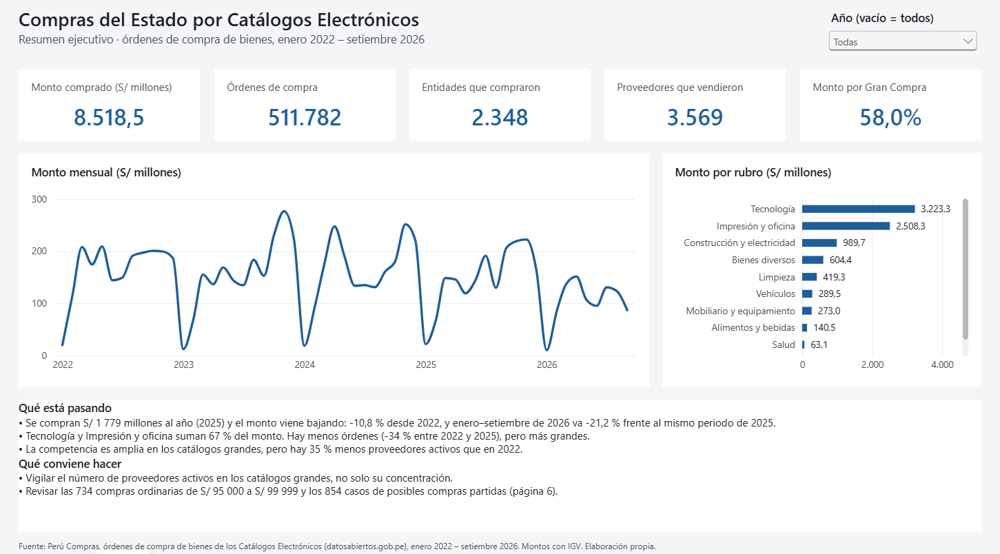
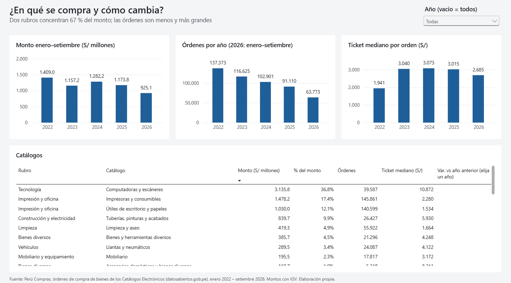
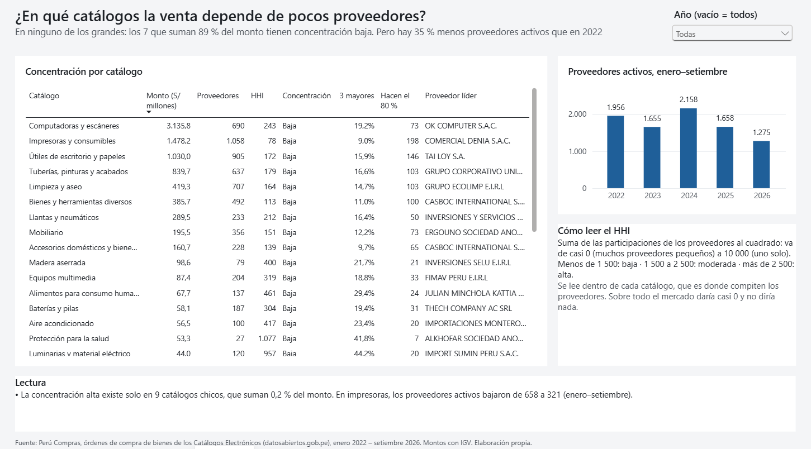
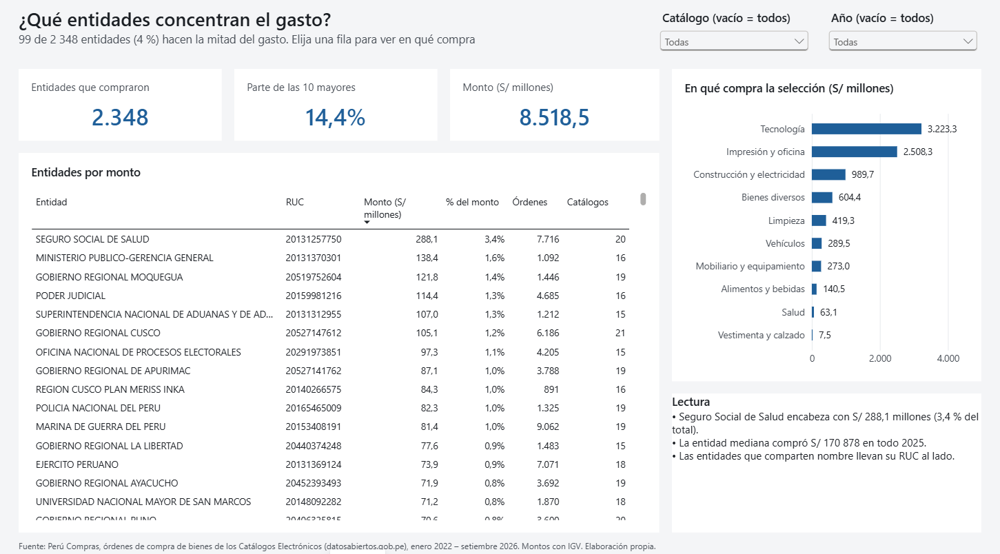
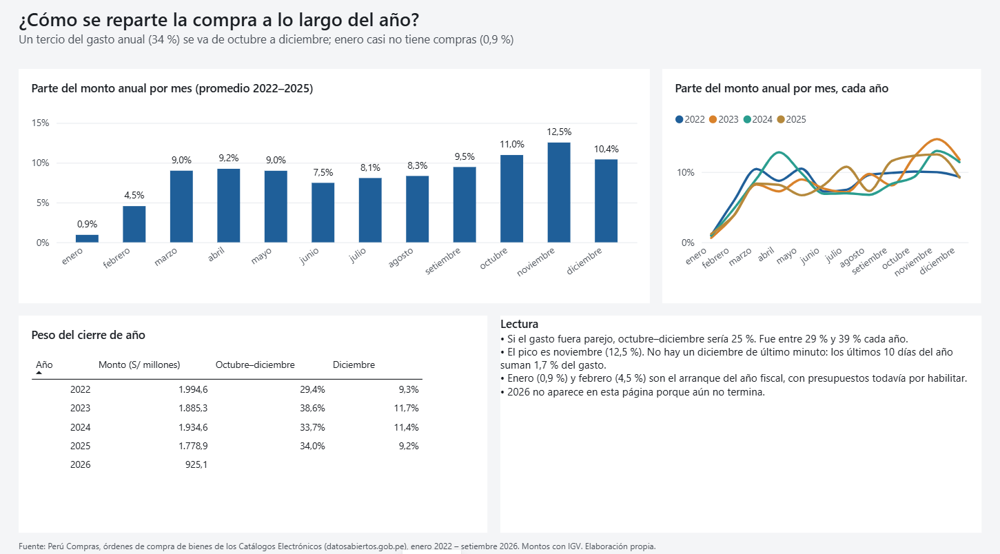
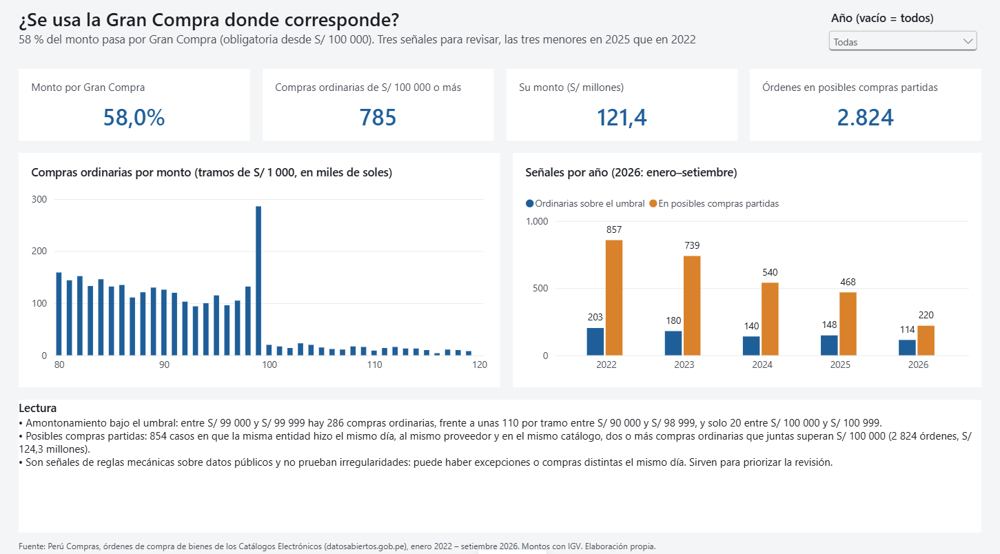
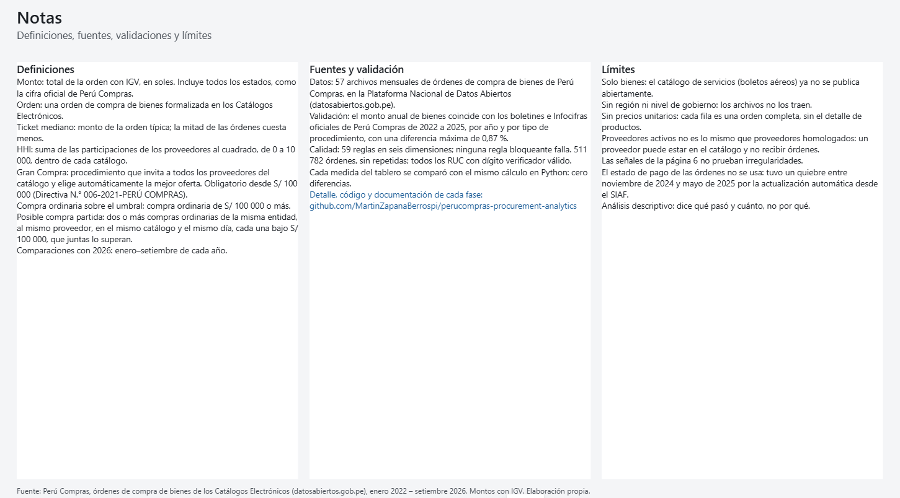

# Tablero de Power BI (PBIP)

> Fase 6 · Estado: **cerrada** (2026-10-13). **[Ver el tablero publicado](https://app.powerbi.com/view?r=eyJrIjoiZjYzMGVmYjAtNWMwNS00Y2RkLTliM2UtZjk5ZmJkNmRmMWYzIiwidCI6IjFlYmE0NDNmLTIzZTUtNDUzNC05MGQxLTA5NzZhYWJlODZhYyIsImMiOjR9)**

El informe se guarda como **Power BI Project**: el modelo en TMDL y el informe en PBIR (JSON),
todo en texto, revisable en GitHub sin abrir Power BI. **Ninguno de los dos se armó a mano.** Los
generan dos scripts, así que cada visual, medida y relación está en el historial de cambios:

```bash
python tools/build_model.py    # modelo: tablas, relaciones y 45 medidas DAX
python tools/build_report.py   # informe: 7 páginas, 56 visuales, tema propio
```

## Cómo abrirlo

1. Clona el repositorio. Los datos que lee el tablero (`data/curated/*.csv`) vienen incluidos: no
   hace falta ejecutar el pipeline.
2. Abre `perucompras.pbip` con **Power BI Desktop** (se construyó con la versión 2.157; necesita
   soporte para el formato de informe PBIR).
3. Si clonaste en otra carpeta: *Inicio → Transformar datos → Editar parámetros* y cambia
   **`RutaDatos`** por la ruta de tu copia de `data/curated/`, con la barra final.
4. *Inicio → Actualizar*. El repositorio no guarda la caché de datos (`.pbi/cache.abf`), así que
   el primer refresco es obligatorio. Carga 511 782 órdenes en menos de un minuto.

## Páginas

Cada página tiene el mismo esquema:
- **título:** la pregunta;
- **subtítulo:** la respuesta;
- **visuales:** la evidencia;
- **"Lectura":** qué significa para gerencia;
- **pie:** la fuente.

Los textos toman sus cifras de [`reports/analisis/cifras_clave.csv`](../reports/analisis/cifras_clave.csv).
Ninguna cifra se escribió a mano, así que el tablero no puede contradecir al análisis.

| Página | Pregunta | Qué tiene |
|---|---|---|
|  **1. Resumen** | Resumen ejecutivo | 5 indicadores, monto mensual, monto por rubro, "qué está pasando" y "qué conviene hacer" |
|  **2. Catálogos** (P1) | ¿En qué se compra y cómo cambia? | Monto enero–setiembre por año, órdenes y ticket mediano por año, tabla de los 29 catálogos |
|  **3. Concentración** (P2) | ¿Dónde se depende de pocos proveedores? | HHI, 3 mayores, proveedores para el 80 % y proveedor líder por catálogo; proveedores activos enero–setiembre |
|  **4. Entidades** (P3) | ¿Quién concentra el gasto? | Las 2 348 entidades por monto; al elegir una, el gráfico muestra en qué rubros compra |
|  **5. Calendario** (P4) | ¿Cuándo se compra? | Parte del año por mes (promedio y por año), peso de octubre–diciembre |
|  **6. Gran Compra** (P5′) | ¿Se usa la Gran Compra donde corresponde? | Histograma de compras ordinarias alrededor de S/ 100 000; señales por año |
|  **7. Notas** | | Definiciones, fuentes, validación y límites |

**Segmentadores.** Año en todas las páginas con datos y catálogo en *Entidades*. Vacío significa
todo el periodo.

## Decisiones de diseño

- **Una pregunta por página**, con la respuesta en el subtítulo. Un gerente entiende la página sin
  mirar los gráficos.
- **Comparaciones justas con 2026.** Como 2026 llega hasta setiembre:
  - los gráficos por año usan enero–setiembre;
  - la página *Calendario* solo muestra años completos;
  - la variación interanual aparece solo al elegir un año, porque sobre varios años no tiene
    sentido.
- **Montos en millones sin abreviar.** Power BI abrevia por defecto ("3,2 mil" en lugar de
  3 223,3). Se desactivó en etiquetas, ejes y tarjetas.
- **Histograma en tramos de S/ 1 000.** Es la evidencia más clara de la P5′: el tramo de
  S/ 99 000 tiene 286 órdenes; sus vecinos, unas 110, y el de S/ 100 000, 20. La columna
  `tramo_umbral_miles` se calcula en el modelo, y una medida deja fuera las órdenes que no caen en
  ningún tramo.
- **Nombres repetidos con RUC.** Las tablas usan `entidad_unica`, así que las tres
  *Municipalidad Distrital de Miraflores* aparecen por separado.
- **Tema propio** ([`PeruCompras.json`](perucompras.Report/StaticResources/RegisteredResources/PeruCompras.json)):
  un color de acento, fondo gris claro y tarjetas blancas, sin sombras ni bordes. Nada compite
  con los datos.

## Cómo se verificó

1. **Pruebas automáticas** ([`tests/test_powerbi.py`](../tests/test_powerbi.py)), en GitHub
   Actions:
   - ningún visual se sale del lienzo de 1280 × 720 ni se encima con otro;
   - cada medida y columna que usa un visual existe en el modelo;
   - cada página tiene título y pie;
   - los archivos versionados son exactamente los que producen los generadores.
2. **Medidas contra Python.** 363 comparaciones en Power BI Desktop, cero diferencias (ver la
   [Fase 4](../docs/04_modelado.md)).
3. **Revisión visual de cada página** en Power BI Desktop. Encontró y corrigió:
   - montos abreviados ("3,2 mil", "512 mil");
   - un histograma aplastado por el grupo "(En blanco)";
   - un eje mensual con barra de desplazamiento;
   - una variación interanual sin sentido sin año elegido;
   - columnas cortadas y un título encimado con un segmentador.

## Capturas

`docs/img/` se genera con dos scripts. El primero cambia de página con UI Automation y captura la
ventana con `PrintWindow`, sin mover el mouse ni quitarle el foco a otras ventanas. El segundo
recorta el lienzo:

```powershell
powershell -ExecutionPolicy Bypass -File tools\capturas.ps1 -Salida <carpeta>
python tools\recortar_capturas.py <carpeta>
```

## Qué hay en cada carpeta

```
powerbi/
├── perucompras.pbip                        # lo que se abre en Power BI Desktop
├── perucompras.SemanticModel/definition/
│   ├── model.tmdl · expressions.tmdl       # cultura es-PE, parámetro RutaDatos
│   ├── relationships.tmdl                  # 5 relaciones
│   └── tables/                             # 6 tablas y _Medidas (45 medidas)
└── perucompras.Report/
    ├── definition/pages/                   # 7 páginas, un visual por carpeta
    └── StaticResources/RegisteredResources/PeruCompras.json   # tema
```
